<picture>
  <source media="(prefers-color-scheme: dark)" srcset="https://raw.githubusercontent.com/berkayerdemsoy/berkayerdemsoy/main/assets/hero-dark.svg">
  <source media="(prefers-color-scheme: light)" srcset="https://raw.githubusercontent.com/berkayerdemsoy/berkayerdemsoy/main/assets/hero-light.svg">
  
</picture>

  <a href="https://berkayerdemsoy.dev"><picture><source media="(prefers-color-scheme: dark)" srcset="https://raw.githubusercontent.com/berkayerdemsoy/berkayerdemsoy/main/assets/btn-portfolio-dark.svg"></picture></a>
  <a href="https://akissy.com"><picture><source media="(prefers-color-scheme: dark)" srcset="https://raw.githubusercontent.com/berkayerdemsoy/berkayerdemsoy/main/assets/btn-akissy-dark.svg"></picture></a>
  <a href="https://www.linkedin.com/in/berkay-erdemsoy"><picture><source media="(prefers-color-scheme: dark)" srcset="https://raw.githubusercontent.com/berkayerdemsoy/berkayerdemsoy/main/assets/btn-linkedin-dark.svg"></picture></a>
  <a href="https://medium.com/@berkayerdemsoy"><picture><source media="(prefers-color-scheme: dark)" srcset="https://raw.githubusercontent.com/berkayerdemsoy/berkayerdemsoy/main/assets/btn-medium-dark.svg"></picture></a>

I am a Computer Engineering student and Software Developer driven by a deep curiosity for **System Architectures**. In every structure I encounter, I strive to go deeper by asking the "why" and "how" behind the technology. My journey has taught me that successful engineering is more than just writing code; it's about managing real-world use cases and maintaining effective communication at the heart of every solution.

## About Me

My primary focus is the **Java** and **Spring Boot** ecosystem, where I enjoy building scalable and optimized systems. I am highly passionate about **Software Architecture** and **DevOps** principles, aiming to create sustainable value for products and teams by implementing modern best practices and robust cloud infrastructures.

## What I'm Working On

**Akissy (Live Event Management System):** I am currently developing and maintaining a scalable, secure microservices-based platform, actively live at [akissy.com](https://akissy.com).
* **Architecture:** Utilizing **Eureka** for service discovery, **Apache Kafka** for event-driven messaging, and **Traefik** for boundary security and API gateway management.
* **Communication:** Implementing both **synchronous and asynchronous** communication patterns between services to ensure high availability and resilience.
* **Goal:** Building a high-performance system that handles complex event flows while maintaining strict security standards in a production environment.

<picture>
  <source media="(prefers-color-scheme: dark)" srcset="https://raw.githubusercontent.com/berkayerdemsoy/berkayerdemsoy/main/assets/arch-dark.svg">
  <source media="(prefers-color-scheme: light)" srcset="https://raw.githubusercontent.com/berkayerdemsoy/berkayerdemsoy/main/assets/arch-light.svg">
  
</picture>

## Tech Stack

* **Backend:** Java, Spring Boot, Microservices, C/C++, Python
* **Cloud & DevOps:** Docker, AWS (EC2, S3), Jenkins, Linux (Ubuntu), Git
* **Messaging & Security:** Apache Kafka, Redis, Keycloak (OAuth2/OIDC)
* **Database:** PostgreSQL, MySQL, Liquibase, QueryDSL
* **Frontend:** Angular, Vue.js

## Experience & Projects

* **HAVELSAN (Long-term Intern):** Worked within the KOVAN adaptation projects team, resolving issues in live production systems and managing containerization with Docker Compose.

 

<picture>
  <source media="(prefers-color-scheme: dark)" srcset="https://raw.githubusercontent.com/berkayerdemsoy/berkayerdemsoy/output/github-contribution-grid-snake-dark.svg">
  <source media="(prefers-color-scheme: light)" srcset="https://raw.githubusercontent.com/berkayerdemsoy/berkayerdemsoy/output/github-contribution-grid-snake.svg">
  
</picture>
